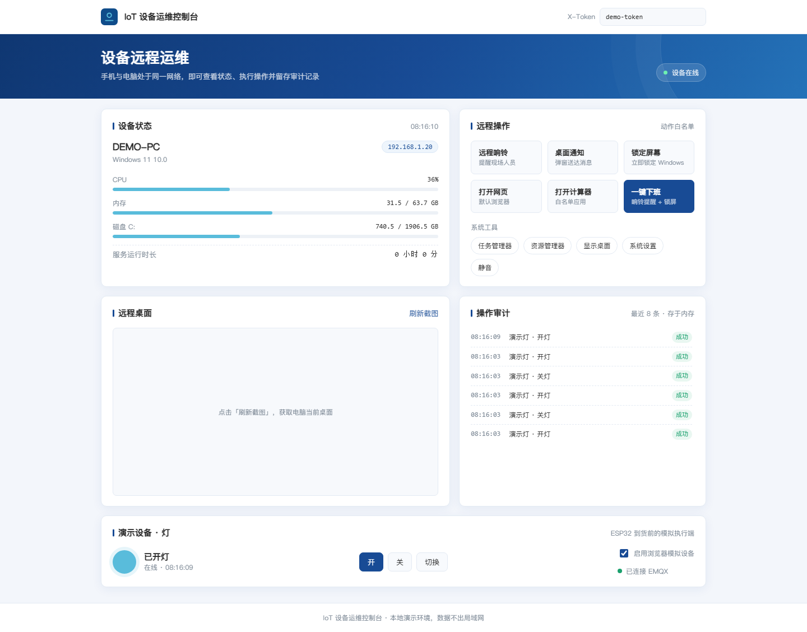
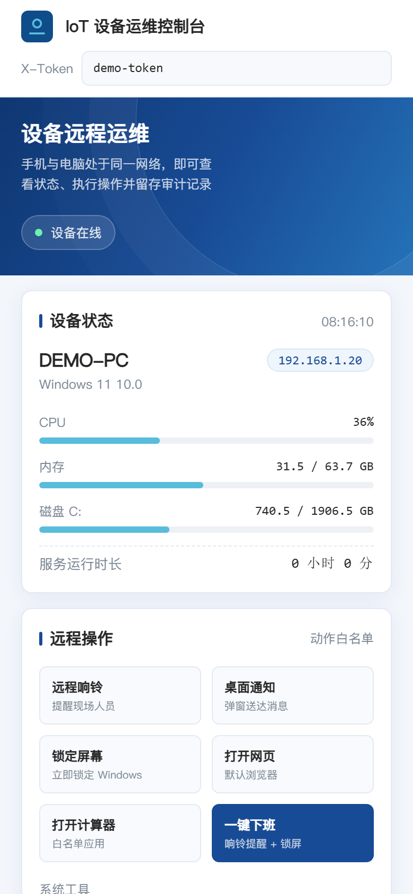

# IoT 设备运维控制台

一个运行在局域网内的轻量物联网设备运维平台，打通 **iPhone 快捷指令 / Web 控制台 → HTTP 网关 → MQTT → ESP32 / 电脑执行器** 的完整链路。不依赖公网、云平台和第三方 App，电脑上双击一个脚本即可启动。



<p align="left">
  
</p>

## 功能

- **设备控制**：灯的开、关、切换，支持 ESP32 真机或浏览器模拟设备
- **电脑远程操作**：远程响铃、桌面通知、锁屏、打开网页/计算器、任务管理器、资源管理器、显示桌面、系统设置、静音
- **状态监控**：主机名、系统版本、CPU、内存、磁盘、服务运行时长，5 秒自动刷新
- **远程桌面**：抓取电脑当前屏幕，手机端可直接查看
- **操作审计**：动作白名单 + 中文操作记录 + 成功/失败状态，内存保留最近 50 条
- **手机控制**：iOS 快捷指令直接调用 HTTP 接口，可放到桌面或用 Siri 触发
- **本地优先**：全部服务运行在本机或局域网，数据不出内网

## 架构

```
iPhone 快捷指令 ─┐
                 ├─ HTTP (X-Token) ─ Spring Boot ─ MQTT ─ EMQX ─┬─ ESP32 / 继电器
Web 控制台 ──────┘                                              └─ 电脑执行器
```

- 浏览器模拟设备通过 MQTT over WebSocket 扮演 ESP32，用于无硬件时联调
- ESP32 与电脑执行器订阅同一套主题，服务端不区分执行端类型
- 服务端按设备白名单校验动作，未注册的设备或动作直接拒绝

## 技术栈

| 层次 | 选型 |
| --- | --- |
| 设备端 | ESP32 + Arduino + PlatformIO，PubSubClient、ArduinoJson |
| 消息 | EMQX 5.x（Docker），QoS 1，遗嘱消息 |
| 后端 | JDK 17、Spring Boot 3.3、Maven、Eclipse Paho MQTT |
| 前端 | 原生 HTML / CSS / JavaScript，无构建步骤 |
| 手机端 | iOS 快捷指令「获取 URL 内容」POST JSON |

## 快速开始

### 环境要求

- JDK 17+、Maven 3.9+
- Docker Desktop（用于 EMQX）
- Windows（电脑执行器依赖 Windows 命令与 Core Audio）

### 一键启动（Windows）

```powershell
.\start.bat
```

脚本会依次启动 EMQX 容器、构建并启动服务端，然后打开 `http://localhost:8081/`。

### 手动启动

```powershell
docker compose up -d
cd server
mvn spring-boot:run
```

访问 `http://localhost:8081/`，默认 Token 为 `dev-token-change-me`。

### 无硬件联调

打开控制台后勾选「启用浏览器模拟设备」，页面会通过 MQTT WebSocket 扮演 ESP32，此时可以直接测试开灯、关灯与审计记录。

## 手机控制

1. iPhone 与电脑连接同一 Wi-Fi
2. 新建快捷指令，添加「获取 URL 内容」动作
3. 方法选 `POST`，URL 填 `http://<电脑IP>:8081/api/devices/light/commands`
4. 请求头添加 `X-Token`，请求体选 JSON，加字段 `action` = `on` / `off` / `toggle`
5. 保存后放到桌面，或命名为「开灯」用 Siri 触发

详细步骤见 [docs/shortcut-setup.md](docs/shortcut-setup.md)。

## 接口

### 下发指令

```bash
curl -X POST http://localhost:8081/api/devices/light/commands \
  -H "Content-Type: application/json" \
  -H "X-Token: dev-token-change-me" \
  -d '{"action":"on"}'
```

| 设备 | 可用动作 |
| --- | --- |
| `light` | `on`、`off`、`toggle` |
| `pc` | `beep`、`notify`、`lock`、`open`、`calc`、`taskmgr`、`explorer`、`desktop`、`settings`、`mute` |

### 其他接口

| 方法 | 路径 | 说明 |
| --- | --- | --- |
| GET | `/health` | 服务与 MQTT 状态 |
| GET | `/api/devices/{id}/state` | 设备状态 |
| GET | `/api/pc/stats` | 主机指标 |
| GET | `/api/pc/screenshot` | 当前屏幕截图 |
| GET | `/api/pc/audit` | 最近操作记录 |

## MQTT 主题

| 主题 | 方向 | 说明 |
| --- | --- | --- |
| `home/light/cmd` | 服务端 → 设备 | 指令 `1` / `0` |
| `home/light/state` | 设备 → 服务端 | 状态，retained + 遗嘱消息 |
| `home/pc/cmd` | 服务端 → 执行器 | 电脑动作 |
| `home/pc/state` | 执行器 → 服务端 | 在线状态 |

## ESP32 固件

```bash
cd firmware
# 复制并填写本地配置，secrets.h 已被 .gitignore 忽略
copy include\secrets.example.h include\secrets.h
pio run -t upload
```

`secrets.h` 需要填写 Wi-Fi 名称、密码和运行服务端电脑的局域网 IP。注意 ESP32 只支持 2.4GHz Wi-Fi。

## 目录结构

```
.
├── server/                 Spring Boot 服务端
│   └── src/main/
│       ├── java/           HTTP、MQTT、设备与审计
│       └── resources/
│           ├── static/     控制台页面与图标
│           ├── mute.ps1    Windows 静音脚本（Core Audio）
│           └── application.yml
├── firmware/               ESP32 固件（PlatformIO）
├── docs/                   截图与手机配置说明
├── docker-compose.yml      EMQX
├── start.bat / start.ps1   Windows 一键启动
└── SPEC.md                 需求与技术规格
```

## 安全说明

- 默认 Token 仅用于本地演示，部署前请通过环境变量 `API_TOKEN` 注入随机值：

  ```powershell
  $env:API_TOKEN = "你的随机口令"
  ```

- 当前为局域网演示版本，未启用 MQTT 认证与 TLS。不要将 1883 端口直接暴露到公网
- 如需外网访问，建议只暴露 443，并在前面加 HTTPS 反向代理与访问控制
- 「锁定屏幕」「显示桌面」「静音」等动作会直接影响电脑，演示时请留意

## 说明

本项目为个人学习与演示项目，界面与代码均为本地实现。无硬件时可用浏览器模拟设备完成全链路验证。
